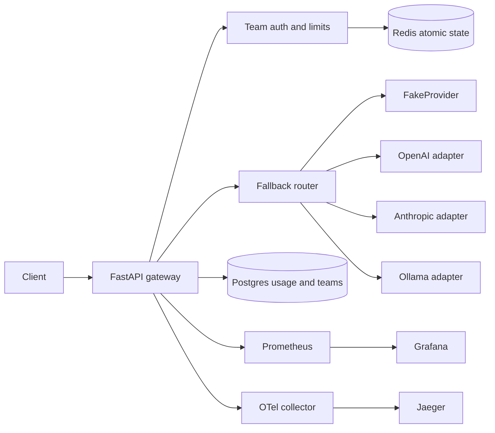

# LLM Gateway

An OpenAI-compatible gateway built in stages. It provides health checks and chat
completions through FakeProvider, OpenAI, Anthropic, or Ollama, with configurable aliases,
fallback routing, budgets, rate limits, and observability.

## Architecture



## Stage 1: run locally

```powershell
py -3.11 -m venv .venv
.\.venv\Scripts\Activate.ps1
python -m pip install -e ".[dev]"
Copy-Item .env.example .env
uvicorn app.main:app --reload
```

Check `http://localhost:8000/health` and `http://localhost:8000/ready`, then send:

```powershell
Invoke-RestMethod -Method Post -Uri http://localhost:8000/v1/chat/completions `
  -ContentType 'application/json' `
  -Body '{"model":"fake-model","messages":[{"role":"user","content":"Hi"}]}'
```

## Run with Docker Compose

```powershell
docker compose up --build
```

Compose starts the gateway, Redis, Postgres, Prometheus, the OpenTelemetry collector,
Jaeger, and Grafana. Set the required values in `.env` and apply the Alembic migrations
before sending authenticated requests. Ollama is optional: run
`docker compose --profile ollama up --build`.

## Model aliases and providers

Aliases and their provider/model targets are in `config/routes.yaml`. Targets are tried
in order, with fallback behavior configured in `config/fallback.yaml`.
Set `OPENAI_API_KEY` and `ANTHROPIC_API_KEY` in `.env` to use those providers. Ollama is
local and uses `OLLAMA_BASE_URL`. `GET /v1/models` lists configured aliases and models.

## Stage 3: teams and keys

Set `ADMIN_TOKEN`, `POSTGRES_USER`, and `POSTGRES_PASSWORD` in `.env`. Set `DATABASE_URL`
to the Postgres service address, for example
`postgresql+asyncpg://<user>:<password>@postgres:5432/gateway`; keep credentials private
and URL-encode reserved characters. Then start the database and initialize the schema:

```powershell
docker compose up -d postgres redis
docker compose run --rm gateway alembic upgrade head
docker compose up --build
```

Create a team with `POST /admin/teams` and an `Authorization: Bearer <ADMIN_TOKEN>`
header, then create a key with `POST /admin/teams/{team_id}/keys`. Include a team-name,
for example `{"name":"demo","allowed_models":["*"]}`. Save the returned
`api_key` then: the gateway stores only its SHA-256 hash and returns the full key only
from that creation call. Team chat requests require `Authorization: Bearer gw_live_...`.
The default `allowed_models: ["*"]` permits every configured model; replace it with an
explicit alias/model list to restrict a team. Empty `allowed_models` permits no models.
Team authorization snapshots are cached in Redis for `TEAM_CACHE_TTL_SECONDS`; revoke
and team update operations invalidate their cached entries immediately. If Redis is
unavailable, key checks fall back to Postgres and cache writes are skipped.

## Stage 4: Redis token buckets

Each authenticated chat call atomically consumes one request unit and an estimated token
cost from two team buckets. The sustained refill rates come from `rpm_limit` and
`tpm_limit`; `rpm_burst_capacity` and `tpm_burst_capacity` optionally set per-team burst
caps. If those overrides are null, `config/rate_limits.yaml` applies independent burst
multipliers. That file also configures the Stage 4 character-based token estimate,
default reserved completion size, Redis key lifetime, and `redis_failure_policy`.

The default Redis policy is `closed`: a Redis failure returns HTTP 503. Set it to `open`
to allow the request through with `X-Gateway-RateLimit-Status: unavailable`. A bucket
rejection returns HTTP 429 with an OpenAI-style `error` object, `Retry-After`, and
request/token remaining and reset headers. The Lua script reads, refills, checks, and
debits both buckets in one Redis execution, so concurrent gateway instances cannot race
between a read and a write.

## Stage 5: token pricing and monthly budgets

`config/pricing.yaml` holds per-model input and output USD prices per million tokens.
Pre-call token estimates use `tiktoken` for recognized OpenAI model names and the
configured character heuristic for other models. Before calling a provider, the gateway
atomically reserves worst-case estimated cost in Redis. A request that would exceed a
positive monthly budget receives HTTP 402; a budget of `0` means unlimited. On success,
provider-reported token usage determines actual cost and atomically replaces the
reservation. Provider errors release their reservation. Redis budget keys are scoped to
the UTC month and expire at month end.

## Stage 6: retries, fallbacks, and circuit breakers

`config/fallback.yaml` controls per-provider retries, exponential backoff and jitter,
per-attempt and overall timeouts, and Redis-backed circuit breaker thresholds and
cooldowns. Retries apply to transient timeouts, rate limits, and upstream server errors;
client errors stop immediately. When a target exhausts retries, the router advances to
the next configured target. Open breakers are skipped; a limited half-open probe checks
whether a provider has recovered. `breaker_redis_failure_policy` controls whether Redis
errors allow provider calls or fail the route closed.

The budget reservation uses the highest estimated price among team-eligible fallback
targets. Successful responses include `X-Gateway-Provider`, `X-Gateway-Attempts`, and
`X-Gateway-Fallback`; usage records track the provider and model that served the call.
## Stage 7: streaming chat completions

Set `"stream": true` on `/v1/chat/completions` to receive OpenAI-compatible
`text/event-stream` chunks followed by `data: [DONE]`. The OpenAI, Anthropic, Ollama,
and FakeProvider adapters translate their upstream text deltas into the same gateway
format. Authentication, rate limiting, and worst-case budget reservation run before
the stream starts. On normal completion, estimated streamed usage reconciles the budget
and writes a usage record. A provider may be retried or failed over before the first
text delta; after output begins, a disconnect cannot safely switch providers, so the
gateway emits an SSE error event and ends the stream. Provider token usage is not
available consistently in upstream streaming events, so stream usage is estimated from
the configured character-to-token heuristic.

## Stage 8: observability

`GET /metrics` exposes Prometheus counters, histograms, and gauges for request volume and
latency, provider attempts, successful fallback transitions, token and cost totals,
rate limits, circuit state, and monthly budget use. Team/model/provider/status are the
only dimensions used for request metrics; prompts, completions, credentials, and request
IDs are never metric labels. Team labels can still create many time series in a large
installation, so use a bounded team population or add a metrics aggregation layer as it
grows.

Each HTTP request receives an `X-Request-ID` response header (a valid supplied ID is
preserved). Logs use JSON and include this ID plus the active trace ID without recording
request or response content. OpenTelemetry creates a server span with auth, rate-limit,
budget, and provider-attempt child spans. Set `OTEL_EXPORTER_OTLP_ENDPOINT` to send traces
to an OTLP gRPC collector; the default local setting leaves trace export disabled.
`config/observability.yaml` sets the sampling ratio and request latency histogram buckets.

Docker Compose includes Prometheus, an OTLP collector, Jaeger, and Grafana. Configure
`GRAFANA_ADMIN_PASSWORD` in `.env`, then run `docker compose up --build`. Open Prometheus
at `http://localhost:9090`, Jaeger at `http://localhost:16686`, and Grafana at
`http://localhost:3000`; Grafana provisions the gateway overview dashboard on startup.
The `/metrics` endpoint includes team-level usage labels; keep it on a trusted network or
place an authenticated proxy in front of it when deploying outside a local environment.

## Stage 9: hardening

`config/hardening.yaml` sets the request body ceiling, response cache TTL, per-provider
concurrency caps, lease duration, and shutdown drain timeout. Response caching is disabled
by default per team; enable `cache_enabled` through the admin team API to cache exact
normalized requests only when `temperature` is exactly zero and `stream` is false. Cache
keys contain a SHA-256 digest of the team, normalized request, and eligible route chain.
Cache hits still consume rate-limit capacity, skip provider calls and budget charges, and
write a zero-cost usage record. A cache hit returns the original completion response.
Apply `alembic upgrade head` before using the new team cache setting.

Provider caps use atomic Redis leases shared across gateway replicas. A lease expires if a
worker dies; its configured lifetime must exceed the overall routing timeout. During a
Redis outage the default concurrency policy allows calls without a lease, so capacity is
not enforced until Redis recovers. On shutdown, the app stops admitting new requests and
waits up to the configured drain timeout before closing shared clients. Team API keys can
be rotated with `POST /admin/teams/{team_id}/keys/rotate`; optionally pass the old key ID
to revoke it in the same database transaction. Admin endpoints use constant-time bearer
token comparison and never include stored hashes in responses. For upstream key rotation,
set the active key in `OPENAI_API_KEY` or `ANTHROPIC_API_KEY` and temporary comma-separated
overlap keys in the matching `*_API_KEY_FALLBACKS` setting; adapters try the next key only
after an upstream authentication rejection. Remove the retired key after confirming the
new key is active. Key values remain in the environment and are never logged or returned.
If a stream ends after sending output, the gateway reconciles the reservation against
estimated prompt and partial completion tokens and records a `partial` usage row.

The response includes `X-Gateway-Budget-Warning: approaching_limit` when estimated or
actual use reaches `budget_warn_ratio` (default 80%). Usage records are written by a
bounded async queue to Postgres; when full, the response path remains non-blocking and
the dropped row is logged and counted. `GET /v1/usage` returns this month's request,
token, cost, budget, and reserved-cost totals for the authenticated team. Run the latest
Alembic migration before starting the API.

## Shared HTTP client

The application creates one `httpx.AsyncClient` during startup and closes it during
shutdown. Reusing it lets httpx pool TCP connections across requests, reducing setup
latency and avoiding a new socket for every upstream call. Providers will receive this
client as real upstream integrations are added; the fake provider does not need it.

## Checks

```powershell
pytest -q
ruff check .
```

The tests use FakeProvider and do not call real providers. Run them and Ruff before
committing changes.

## Stage 10: load tests and failover demo

The `demo-failover` route in `config/routes.yaml` uses two independent FakeProvider
instances. The authenticated `PUT /admin/fake-provider/fake` endpoint toggles only the
primary fake instance and returns 404 when `ENVIRONMENT=production`. Body:
`{"available":false}` simulates an upstream outage; `true` restores it. The control
requires `Authorization: Bearer <ADMIN_TOKEN>`.

Install k6 separately, start Compose, apply migrations, create a team and team key, then
set `GATEWAY_API_KEY` and `ADMIN_TOKEN` in the shell. For a clean run with enough capacity,
create the demo team with `rpm_limit: 600`, `rpm_burst_capacity: 1200`, and a sufficient
`tpm_limit`. Run `k6 run loadtest/k6/chat.js` for steady traffic. In PowerShell, set
`$env:SCENARIO="burst"` before that command for the ramping burst, or run
`.\loadtest\demo_failover.ps1` to exercise the primary outage and recovery.
Watch Grafana at `http://localhost:3000` and check response headers
`X-Gateway-Provider` and `X-Gateway-Fallback` during failover. Run
`$env:API_KEY="<team key>"; python -m loadtest.benchmark` to measure direct FakeProvider
and gateway p50/p95/p99 latency, RPS, and median overhead for the same synthetic request.
Results are intentionally not fabricated; record the host and run parameters in
[`loadtest/results.md`](loadtest/results.md).

The gateway image uses a separate dependency build stage and runs as the unprivileged
`gateway` user. GitHub Actions runs Ruff, pytest, and `docker build`. Compose brings up the
gateway, databases, and observability stack; set `.env` values as described in Stage 3
before running `docker compose up --build`.

Failover demo capture placeholder: ``
